<div align="center">


# Tovu Calibre Themes

**Six hand-crafted icon themes for [Calibre](https://calibre-ebook.com/), with a one-click installer.**

Line · Clay · Sky · Pencil · Pencil Color · Stickers


[In Calibre](#-in-calibre) · [Installer](#-the-installer) · [Themes](#-the-themes) · [Install](#-quick-start) · [Restore](#-restore-the-original-icons) · [Contents](#-whats-in-the-box)

</div>

<br>

## 📚 In Calibre

This is the real Calibre 9.18 main window with a Tovu theme installed: toolbar, tag browser, search bar, format and series icons all change together.

<picture>
  <source media="(prefers-color-scheme: dark)" srcset="previews/calibre-sky-dark.png">
  <source media="(prefers-color-scheme: light)" srcset="previews/calibre-stickers-light.png">
  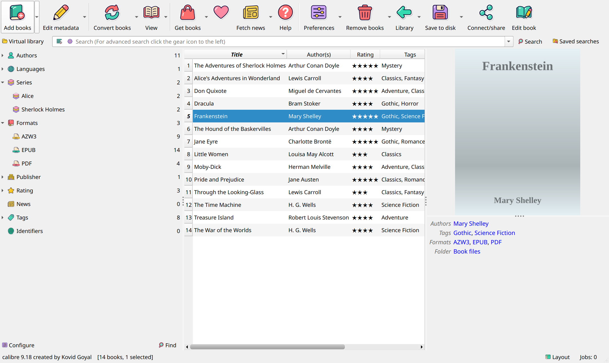
</picture>

<p align="center"><sub>Tovu Stickers in light mode · Tovu Sky in dark mode (GitHub shows the one that matches your appearance)</sub></p>

### Calibre with every theme

<table>
  <tr>
    <td width="50%"></td>
    <td width="50%">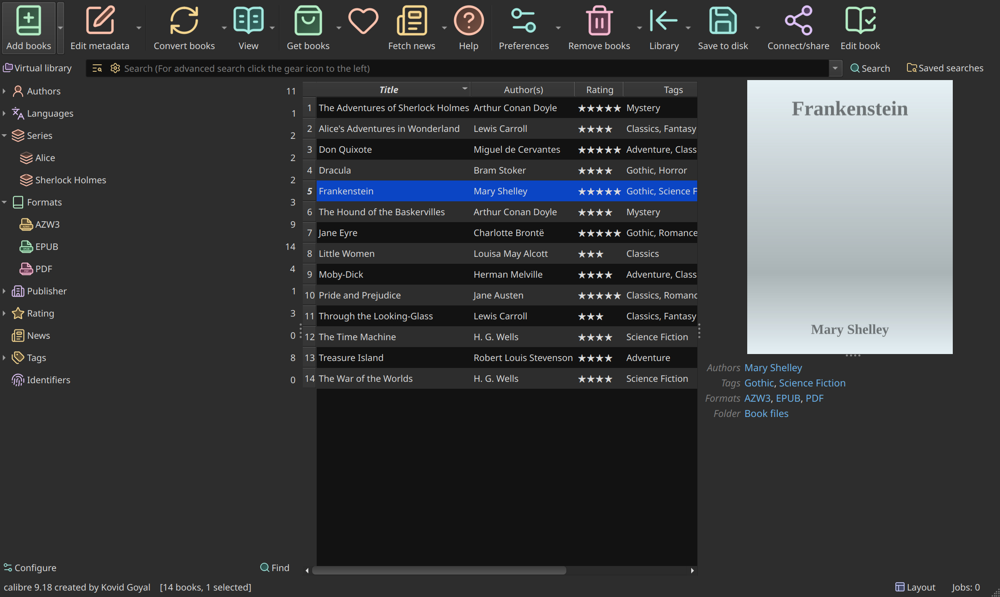</td>
  </tr>
  <tr>
    <td align="center"><sub><b>Stickers</b> · light</sub></td>
    <td align="center"><sub><b>Sky</b> · dark</sub></td>
  </tr>
  <tr>
    <td width="50%">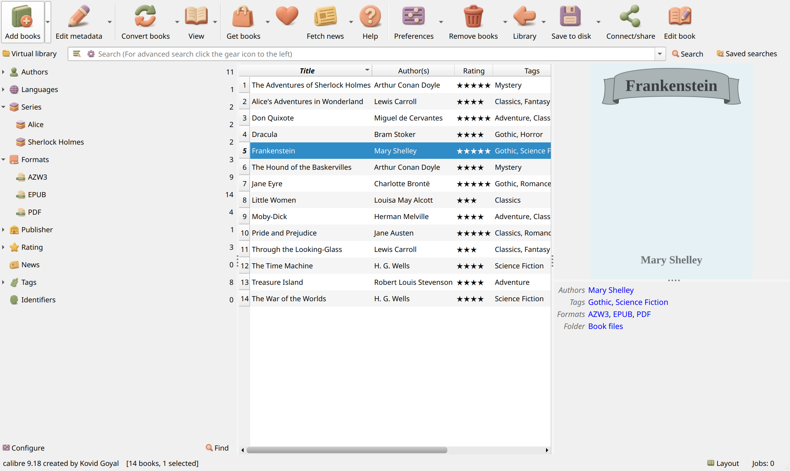</td>
    <td width="50%">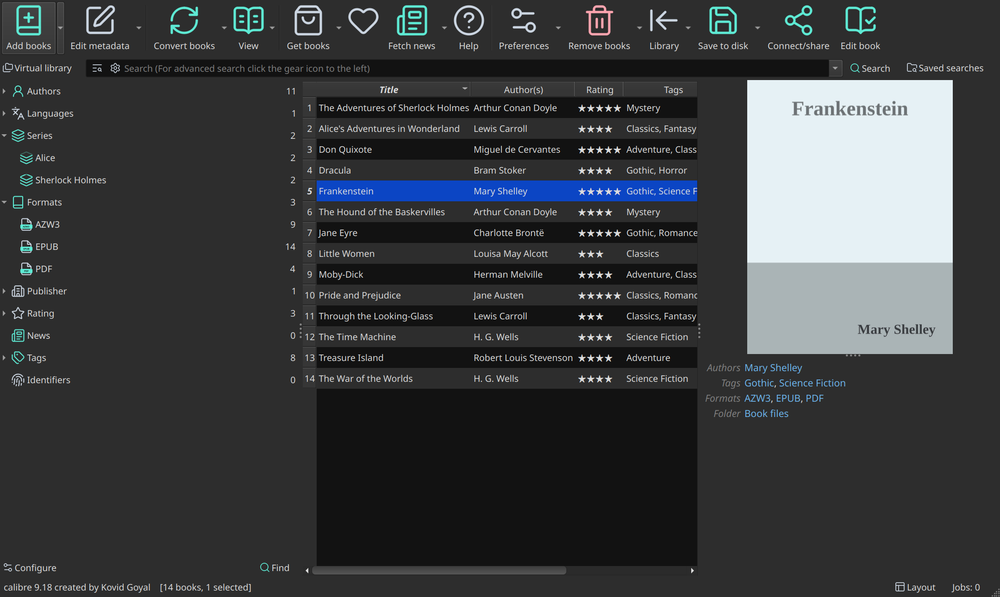</td>
  </tr>
  <tr>
    <td align="center"><sub><b>Clay</b> · light</sub></td>
    <td align="center"><sub><b>Line</b> · dark</sub></td>
  </tr>
  <tr>
    <td width="50%">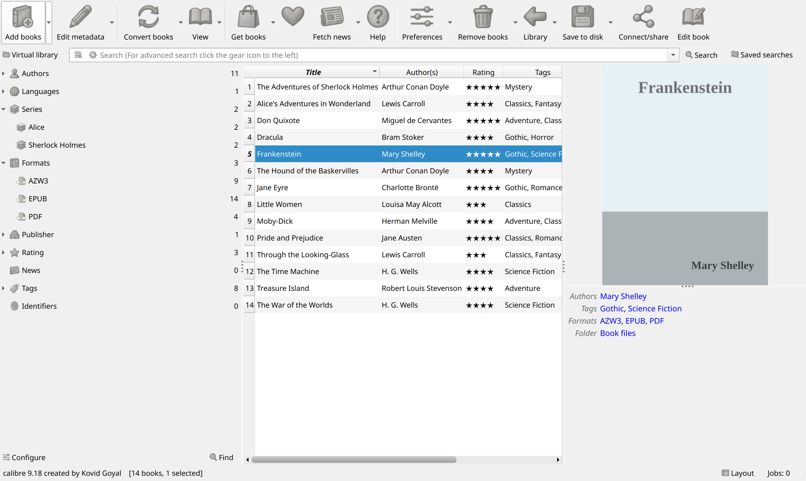</td>
    <td width="50%">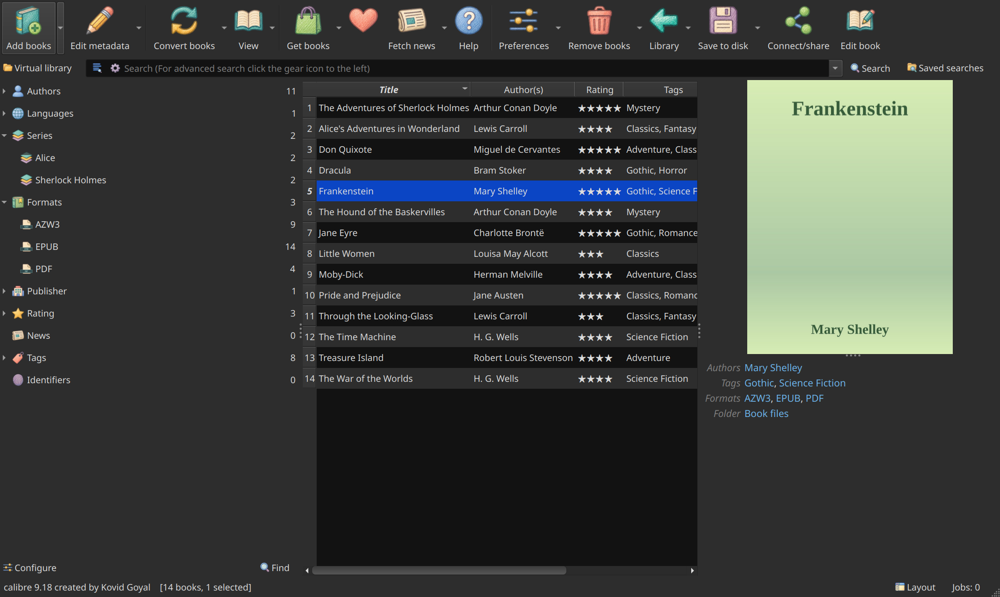</td>
  </tr>
  <tr>
    <td align="center"><sub><b>Pencil</b> · light</sub></td>
    <td align="center"><sub><b>Pencil Color</b> · dark</sub></td>
  </tr>
</table>

<br>

## ✨ The installer

A native Qt assistant that runs on the Calibre already on your computer. Pick a theme from the cards, compare it on light and dark backgrounds, and install it. It follows your system appearance automatically.

<picture>
  <source media="(prefers-color-scheme: dark)" srcset="previews/installer-dark.png">
  <source media="(prefers-color-scheme: light)" srcset="previews/installer-light.png">
  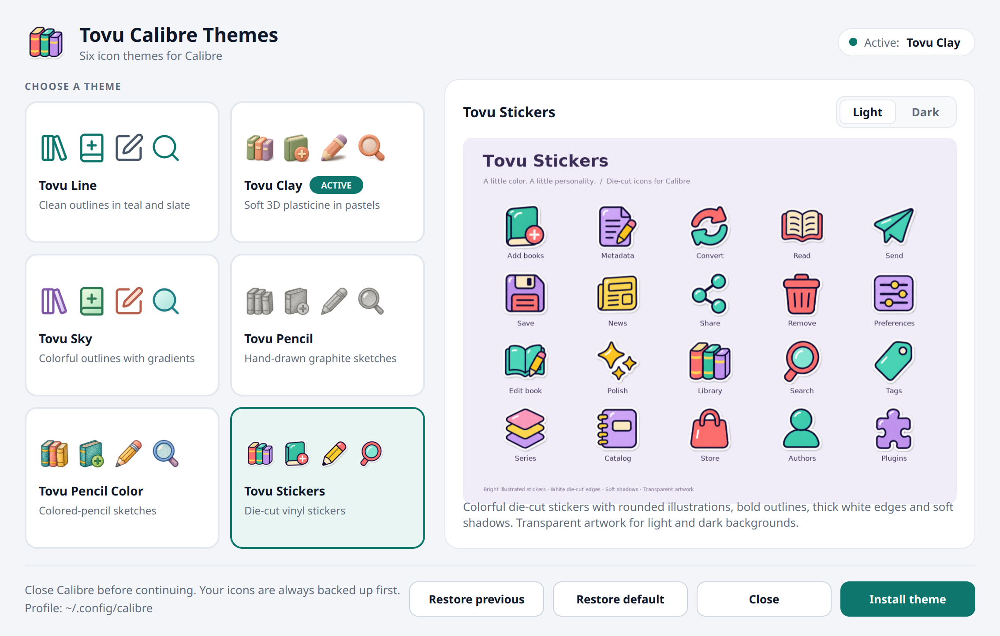
</picture>

### Both modes side by side

<table>
  <tr>
    <td width="50%"></td>
    <td width="50%">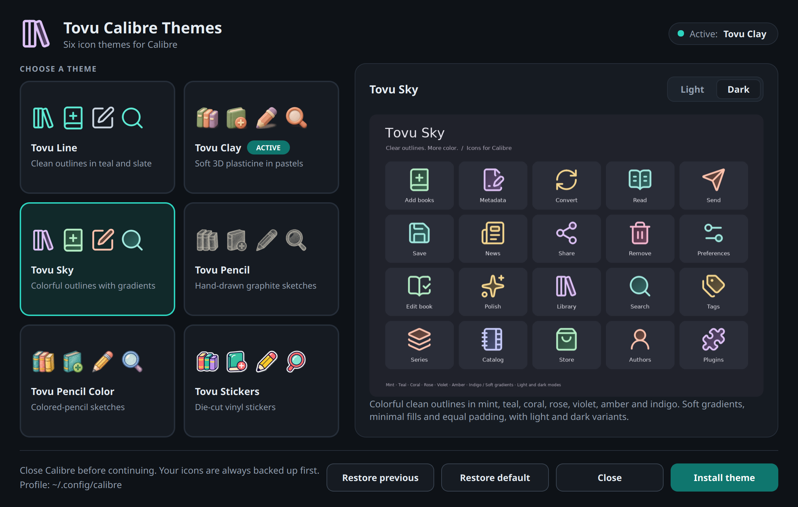</td>
  </tr>
  <tr>
    <td align="center"><sub><b>Light mode</b> · Tovu Stickers selected</sub></td>
    <td align="center"><sub><b>Dark mode</b> · Tovu Sky selected</sub></td>
  </tr>
</table>

- 🎴 **Theme cards** show every option at once, with real icons from each pack.
- 🌗 **Light / Dark switch** previews any theme on either background before installing.
- 🟢 **Active chip and badge** show which theme Calibre is using right now.
- 🛟 **Always backed up.** Your current icons are saved before anything changes.

<br>

## 🎨 The themes

<table>
  <tr>
    <td width="50%" valign="top">
      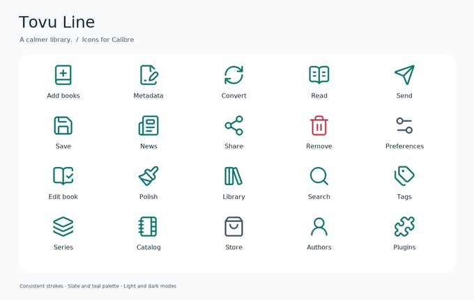
      <h3>Tovu Line</h3>
      Clean, rounded outlines in teal and slate, with separate light and dark artwork.<br>
      <sub><code>--theme line</code> · based on Lucide</sub>
    </td>
    <td width="50%" valign="top">
      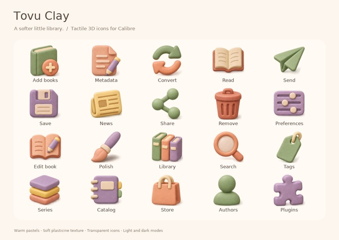
      <h3>Tovu Clay</h3>
      Tactile 3D plasticine: cute rounded forms, warm pastels, soft upper-left lighting and floating shadows.<br>
      <sub><code>--theme clay</code> · works on any background</sub>
    </td>
  </tr>
  <tr>
    <td width="50%" valign="top">
      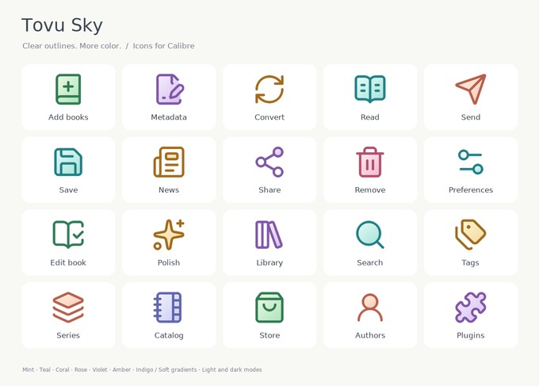
      <h3>Tovu Sky</h3>
      Colorful outlines with gentle gradient fills in mint, teal, coral, rose, violet, amber and indigo.<br>
      <sub><code>--theme sky</code> · light and dark variants</sub>
    </td>
    <td width="50%" valign="top">
      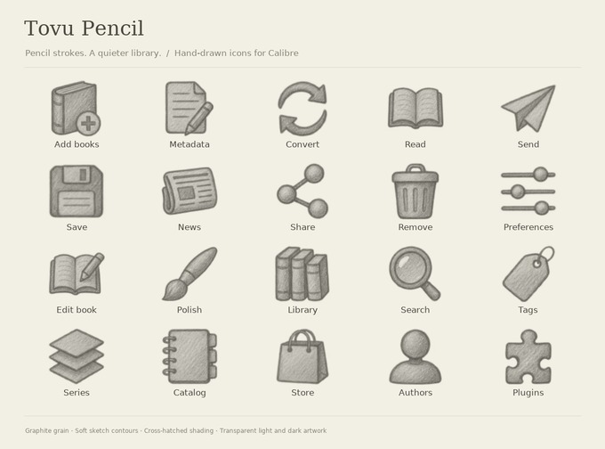
      <h3>Tovu Pencil</h3>
      Hand-drawn graphite with repeated contours, pressure grain and cross-hatched shading.<br>
      <sub><code>--theme pencil</code> · warm and pale graphite variants</sub>
    </td>
  </tr>
  <tr>
    <td width="50%" valign="top">
      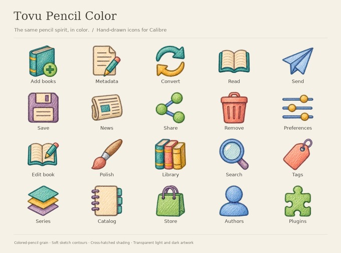
      <h3>Tovu Pencil Color</h3>
      The Pencil pictograms redrawn in colored pencil: teal, coral, green, ochre, blue and violet.<br>
      <sub><code>--theme pencil-color</code> · light and dark variants</sub>
    </td>
    <td width="50%" valign="top">
      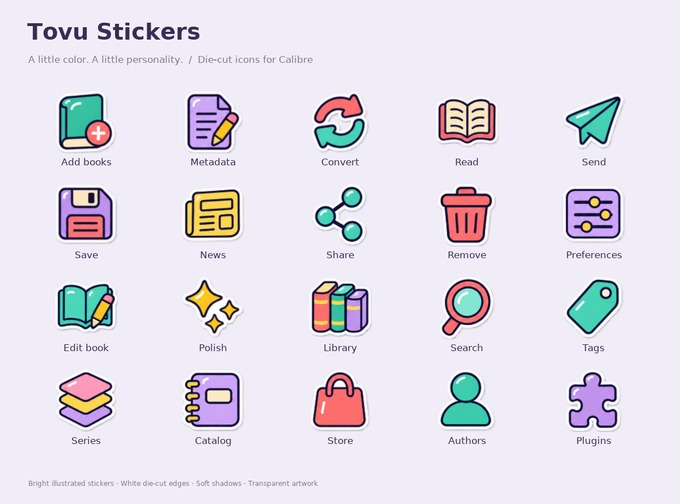
      <h3>Tovu Stickers <sup>default</sup></h3>
      Illustrated vinyl stickers with bold outlines, thick white die-cut edges, tiny highlights and soft shadows.<br>
      <sub><code>--theme stickers</code> · works on any background</sub>
    </td>
  </tr>
</table>

Every theme covers **245 native icon names** in Calibre 9.18: toolbar, menus, editor tools, devices and file formats. That is **735 transparent PNGs** per theme (base, light and dark variants). Every toolbar action has its own icon, and file formats get readable badges.

### 🖼️ Full icon sheets and light/dark presentations

| Theme | Light | Dark | All icons |
| --- | --- | --- | --- |
| Line | [light.png](previews/light.png) | [dark.png](previews/dark.png) | [all-icons.png](previews/all-icons.png) |
| Clay | [light.png](themes/clay/previews/light.png) | [dark.png](themes/clay/previews/dark.png) | [all-icons.png](themes/clay/previews/all-icons.png) |
| Sky | [light.png](themes/sky/previews/light.png) | [dark.png](themes/sky/previews/dark.png) | [all-icons.png](themes/sky/previews/all-icons.png) |
| Pencil | [light.png](themes/pencil/previews/light.png) | [dark.png](themes/pencil/previews/dark.png) | [all-icons.png](themes/pencil/previews/all-icons.png) |
| Pencil Color | [light.png](themes/pencil-color/previews/light.png) | [dark.png](themes/pencil-color/previews/dark.png) | [all-icons.png](themes/pencil-color/previews/all-icons.png) |
| Stickers | [light.png](themes/stickers/previews/light.png) | [dark.png](themes/stickers/previews/dark.png) | [all-icons.png](themes/stickers/previews/all-icons.png) |

<br>

## 🚀 Quick start

1. **Close Calibre.**
2. **Open the `tovu-calibre-themes` folder and run the installer for your system:**

   | System | Installer | From a terminal |
   | --- | --- | --- |
   | 🪟 Windows | Double-click `install-windows.bat` | `install-windows.bat` |
   | 🍎 macOS | Double-click `install-mac.command` | `bash install-mac.command` |
   | 🐧 Linux | Double-click `install-linux.sh` and choose **Run** | `./install-linux.sh` |

3. **Pick a theme**, check it in **Light** and **Dark**, then click **Install theme**.
4. **Reopen Calibre.** Done.

Prefer the terminal? Install directly (same options on every system):

```sh
./install-linux.sh --install --theme stickers   # line · clay · sky · pencil · pencil-color · stickers
./install-linux.sh --status                     # show the active profile and theme
```

On Windows use `install-windows.bat --install --theme stickers`, and on macOS `bash install-mac.command --install --theme stickers`.

> [!NOTE]
> No Internet, administrator rights or extra downloads needed. Each installer uses the theme compiler in your installed Calibre (`calibre-debug`) and finds the active profile itself, including `CALIBRE_CONFIG_DIRECTORY`. On Linux, the first run also creates an `Install Tovu Calibre Themes` shortcut in the folder; it is refreshed every time `install-linux.sh` runs, so it keeps working if you move the folder.

> [!WARNING]
> **Windows and macOS** use the same installer as Linux, but have not been tested on those systems yet. The first time, Windows may show *"Windows protected your PC"*: click **More info → Run anyway**. macOS may say the file is from an unidentified developer: right-click `install-mac.command` → **Open**, or run `bash install-mac.command` in Terminal. If Calibre is installed somewhere unusual, set `CALIBRE_DEBUG` to the full path of `calibre-debug` before running the installer.

<br>

## ↩️ Restore the original icons

| Button | Command | What it does |
| --- | --- | --- |
| **Restore previous** | `uninstall-windows.bat` · `uninstall-mac.command` · `./uninstall-linux.sh` | Returns to the icon theme you had before you first installed Tovu Calibre Themes. |
| **Restore default** | Your system's installer with `--restore-default` | Removes every custom icon theme and override, so Calibre uses its built-in icons. Removed files are saved first to `tovu-backups/<date>-before-default/`. |

> [!TIP]
> Switching between Tovu themes keeps your original backup, so **Restore previous** works even after **Restore default**. Backups live in `tovu-backups/` inside your Calibre profile, and any edits made after installing are kept in `changed-after-install/`.

> [!IMPORTANT]
> **Upgrading from Calibra?** This project was previously called *Calibra*. The installer recognizes a Calibra installation, moves its `calibra-state.json` to `tovu-state.json` and keeps using your `calibra-backups/` folder, so **Restore previous** still brings back the theme you had before.

Calibre's window layout, library, covers, textures and preferences are never touched. Third-party plugins that ship their own icons may need separate adaptations, and icon names added in future Calibre versions fall back to Calibre's defaults until added here.

<br>

## 📁 What's in the box

The themes and the installer need **Calibre 6 or later** on Windows, macOS or Linux, tested with **Calibre 9.18.0**.

| Path | Contents |
| --- | --- |
| `install-windows.bat`, `install-mac.command`, `install-linux.sh` | Installer launchers for each system. |
| `uninstall-windows.bat`, `uninstall-mac.command`, `uninstall-linux.sh` | Restore the icon theme you had before. |
| `installer.py` | Theme selection, native compilation and verified backups. |
| `tovu-line-theme.zip`, `themes/<name>/tovu-<name>-theme.zip` | Each theme in Calibre's native icon-theme format. |
| `manifest.json`, `themes/*/manifest.json` | SHA-256 inventories the installer checks before installing. |
| `theme/`, `themes/*/theme/` | The few icons the installer shows on its theme cards. |
| `previews/`, `themes/*/previews/` | Light/dark presentations, full icon sheets and screenshots. |

The ZIPs are icon themes, not Calibre plugins.

<br>

## 🖌️ Artwork and provenance

- **Line** and **Sky** adapt [Lucide](https://lucide.dev/) 1.73.0 (ISC and MIT notices in [`LICENSE-LUCIDE`](LICENSE-LUCIDE)). Sky adds native gradients to the outlines.
- **Clay**, **Pencil**, **Pencil Color** and **Stickers** are separate raster artworks made with an image-generation tool. Pencil keeps its graphite grain on both light and dark backgrounds.
- Scripts are released under the [MIT license](LICENSE).

<div align="center">
<br>
<sub>Made for Calibre readers who like their toolbar a little nicer · <a href="https://manual.calibre-ebook.com/customize.html">Calibre customization docs</a></sub>
</div>
